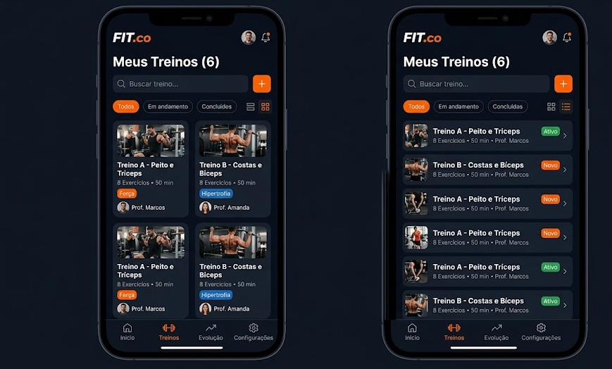
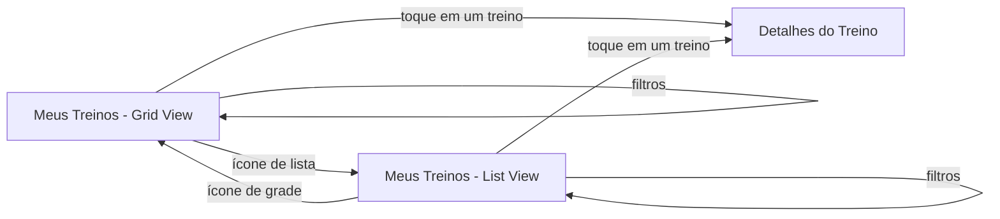

# FIT.co — Protótipo de App de Treinos 🏋️

Protótipo navegável de um aplicativo de treinos para academia, desenvolvido no **Figma** como solução para o desafio de **UX/UI** da [DIO](https://www.dio.me/).

O foco do projeto é a tela **Meus Treinos**, que apresenta os treinos do aluno em dois modos de visualização: **Grid View** e **List View**.

---

## 📌 Sumário

- [Sobre o desafio](#-sobre-o-desafio)
- [Sobre o projeto](#-sobre-o-projeto)
- [Telas](#-telas)
- [Decisões de design](#-decisões-de-design)
- [Fluxo de navegação](#-fluxo-de-navegação)
- [Ferramentas utilizadas](#-ferramentas-utilizadas)
- [Objetivos de aprendizagem](#-objetivos-de-aprendizagem)
- [Links](#-links)
- [Autor](#-autor)

---

## 🎯 Sobre o desafio

O objetivo do desafio é aplicar os conceitos de prototipagem e design de interfaces para criar um **protótipo navegável** no Figma, com uma interface intuitiva que siga os princípios de usabilidade vistos nas aulas.

O desafio tem três etapas:

1. **Criar um wireframe de média ou alta fidelidade**, com tema livre, que seja funcional e esteticamente agradável.
2. **Incluir elementos de visualização**, como **List View** ou **Grid View**, para organizar a informação e facilitar a navegação.
3. **Criar um protótipo navegável no Figma**, permitindo que outras pessoas interajam com o design de forma dinâmica e fluida.

> Material de apoio: *Avançando com Figma e Criação de Protótipos*.

---

## 💡 Sobre o projeto

O **FIT.co** é um app para alunos de academia acompanharem seus treinos montados pelos professores. Na tela **Meus Treinos** o aluno pode:

- Ver todos os seus treinos (contador no título, ex.: *Meus Treinos (6)*);
- **Buscar** um treino pelo nome;
- **Criar** um novo treino pelo botão `+`;
- **Filtrar** os treinos por status: *Todos*, *Em andamento* e *Concluídos*;
- **Alternar** entre **Grid View** e **List View**;
- Navegar pelo app usando a **barra inferior**: *Início*, *Treinos*, *Evolução* e *Configurações*.

Cada treino mostra o nome (ex.: *Treino A - Peito e Tríceps*), a quantidade de exercícios, a duração estimada e o professor responsável.

---

## 📱 Telas

### Grid View

Cards maiores, com imagem em destaque, **tag de objetivo** (*Força*, *Hipertrofia*) e foto do professor. É a visualização mais visual, boa para explorar e reconhecer os treinos pela imagem.

### List View

Linhas compactas com miniatura, nome, informações resumidas e **tag de status** (*Ativo*, *Novo*). Mostra mais treinos por tela e facilita a leitura rápida e a comparação.

| Grid View | List View |
| :---: | :---: |
| Mais visual, com destaque para imagem e objetivo do treino | Mais densa, com destaque para o status do treino |

---

## 🎨 Decisões de design

- **Tema escuro:** combina com o contexto de academia e reduz o cansaço visual durante o uso no treino.
- **Laranja como cor de destaque:** usado em ações principais (botão `+`, filtro ativo, aba ativa da navegação e tags), guiando o olhar do usuário para o que importa.
- **Hierarquia tipográfica:** título da tela em destaque, nome do treino em negrito e informações secundárias (exercícios, duração, professor) em tom mais suave.
- **Tags coloridas:** diferenciam rapidamente objetivo (*Força* em laranja, *Hipertrofia* em azul) e status (*Ativo* em verde, *Novo* em laranja).
- **Alternância Grid/List no topo da lista:** o usuário escolhe como prefere consumir a informação, sem sair da tela.
- **Busca e filtros acima do conteúdo:** seguem o padrão mental de "primeiro encontrar, depois escolher".
- **Barra de navegação inferior:** fica ao alcance do polegar e indica claramente a seção atual.
- **Consistência:** o mesmo cabeçalho, busca, filtros e navegação nas duas visualizações; só o conteúdo muda de formato.

---

## 🔀 Fluxo de navegação

No protótipo, os ícones de visualização alternam entre as telas de Grid e List, e os cards/linhas levam aos detalhes do treino.

---

## 🛠 Ferramentas utilizadas

- [Figma](https://www.figma.com/) — wireframe, design de alta fidelidade e prototipagem
- [GitHub](https://github.com/) — documentação e entrega do projeto

---

## 📚 Objetivos de aprendizagem

Com este desafio foi possível:

- Criar um protótipo de alta fidelidade a partir de um conceito de produto próprio;
- Usar o Figma para criar um protótipo navegável e funcional;
- Aplicar conceitos de usabilidade, como organização de conteúdo e navegação intuitiva;
- Documentar objetivos e decisões de forma clara e organizada no GitHub.

---

## 🔗 Links

- **Protótipo no Figma:** [acessar protótipo](COLOQUE_AQUI_O_LINK_DO_FIGMA)
- **Desafio:** [DIO](https://www.dio.me/)

---

## 👤 Autor

Feito por **SEU NOME** como parte da formação de UX/UI da DIO.

